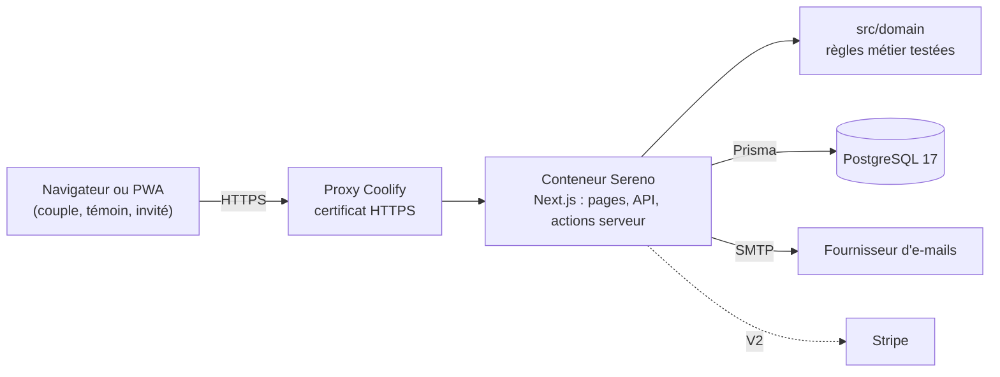

# Cahier des charges technique · Sereno

Ce document décrit comment Sereno est construit, testé et déployé. Il complète le [cahier des charges fonctionnel](https://claude.ai/code/artifact/23a54871-9f09-4049-8e8c-49483d7a331a) et les tickets du dossier [`tickets/`](../tickets/README.md). Le déploiement pas à pas est dans [`DEPLOIEMENT.md`](../DEPLOIEMENT.md).

## 1. Principes

- **Simple à maintenir pour une petite équipe** : un seul langage (TypeScript), une seule application, une seule base, un seul conteneur.
- **Déployable partout** : une image Docker standard, déployée avec Coolify sur un serveur hébergé en Europe.
- **Le métier d'abord, testé** : les règles du cahier des charges (planning, budget, invités) vivent dans `src/domain`, en code pur, sans dépendance au framework ni à la base, et chaque règle a son test.
- **Sobriété** : pas de service externe tant qu'il n'est pas indispensable ; chaque ajout est justifié dans la section 13.

## 2. Pile technique

Toutes les versions sont figées dans `package.json` et `package-lock.json`, et choisies parmi des versions publiées depuis au moins deux semaines.

| Brique | Choix | Version | Pourquoi |
| --- | --- | --- | --- |
| Langage | TypeScript (mode strict) | 5.9.3 | Typage sur tout le projet ; branche 5 retenue, la plus outillée. |
| Environnement | Node.js | 22 (LTS) | Version longue durée, utilisée dans l'image Docker. |
| Application | Next.js (App Router), React | 16.3.8, 19.3.0 | Interface et serveur dans un même projet, rendu serveur, sortie « standalone » pour Docker. |
| Styles | Tailwind CSS | 4.3.3 | Jetons du livre de marque déclarés une fois dans `globals.css`. |
| Base de données | PostgreSQL | 17 | Fiable, relationnelle, sauvegardes gérées par Coolify. |
| Accès aux données | Prisma | 6.19.3 | Schéma lisible, migrations versionnées ; branche 6 retenue pour sa maturité. |
| Validation | Zod | 4.6.5 | Variables d'environnement et données des formulaires. |
| Tests | Vitest | 4.1.11 | Rapide, compatible TypeScript sans configuration. |
| Authentification | Better Auth | 1.7.7 | E-mail et mot de passe, Google et Apple, sessions en base ; télémétrie désactivée. |
| E-mails | SMTP (Nodemailer) | 10.0.15 | Indépendant du fournisseur ; Mailpit en local, affichage dans les logs sans SMTP. |
| Paiement | Stripe (prévu, V2) | — | Paiement du Pass sans stocker de données bancaires (M10). |
| Déploiement | Docker + Coolify | — | Voir `DEPLOIEMENT.md`. |

## 3. Architecture



- **Pages et écrans** : `src/app`, en composants serveur par défaut ; les écrans interactifs (démarrage, plan de table) sont des composants client.
- **Écritures** : par des *Server Actions* Next.js, qui valident les données avec Zod, vérifient les droits du membre (créateur, co-pilote, témoin), écrivent avec Prisma et ajoutent une ligne d'historique (M0-09).
- **Lectures** : directement dans les composants serveur, filtrées par mariage.
- **Pas d'API publique** au MVP, en dehors de `/api/health` et des routes d'authentification.

## 4. Organisation du dépôt

```text
data/modele-taches.json     Modèle de 131 tâches (source unique, chargée en base au démarrage)
docs/                       Documentation technique
prisma/schema.prisma        Schéma de la base
prisma/migrations/          Migrations SQL versionnées
prisma/seed.mjs             Chargement idempotent du modèle de tâches
src/app/                    Pages, layouts, routes (Next.js App Router)
src/domain/                 Règles métier pures et leurs tests (*.test.ts)
src/lib/                    Configuration (env.ts), accès base (db.ts), utilitaires serveur
scripts/docker-entrypoint.sh  Démarrage du conteneur
tickets/                    Une fiche par ticket (également en issues GitHub)
Dockerfile, docker-compose.yml, compose.dev.yml, .env.example
```

## 5. Données

Le schéma (`prisma/schema.prisma`) reprend le modèle de données du cahier des charges, pour le MVP :

- **Authentification** : `user`, `session`, `account`, `verification`, au format Better Auth.
- **Mariage** : `Wedding` (prénoms, date ou date provisoire, date de début, budget, cérémonies, réponses aux questions posées au bon moment, prestataires déjà réservés, Pass) et `Member` (créateur, co-pilote, témoin).
- **Planning** : `TaskTemplate` (le modèle Sereno) et `Task` (les tâches d'un mariage, avec date idéale et date affichée).
- **Budget** : `BudgetCategory`, `Expense`, `Payment`.
- **Invités** : `Household`, `Guest`, `Moment`, `GuestMoment`.
- **Historique** : `ActivityLog`.

Conventions : montants en **centimes d'euro** (entiers, jamais de nombres à virgule), dates du mariage et échéances en **date seule**, identifiants `cuid`, suppression en cascade depuis le mariage (pour honorer le droit à l'effacement d'un coup, M12-04). Toute évolution du schéma passe par une migration (`npm run db:migrate`), relue avant fusion, et compatible avec la version précédente du code.

## 6. Règles métier déjà codées

Le module `src/domain/planning` implémente la génération du planning (tickets M2-01, M2-02, M2-08, M2-11, M2-12, M2-13, M0-11) ; ses 17 tests vérifient notamment :

- le calcul des échéances depuis la date du mariage, au jour près, y compris en fin de mois et au changement d'heure ;
- le filtrage par cérémonie ;
- les tâches d'anticipation, masquées quand le mariage est dans moins d'un an ;
- le resserrement des tâches déjà passées sur les premières semaines, démarches légales d'abord, sans jamais dépasser la veille du mariage, et sans aucune tâche « en retard » le premier jour ;
- les conditions (enfants, brunch, animal, lune de miel) et les tâches cochées d'office quand un prestataire est déjà réservé ;
- la date provisoire à 12 mois quand le mariage n'a pas encore de date.

L'écran `/commencer` utilise ce module : le couple répond aux six écrans, voit son planning, puis crée son compte pour le sauvegarder (les réponses attendent sur l'appareil). Le module `src/domain/mariage` prépare alors le mariage, ses tâches et ses 11 postes de budget, en une seule transaction.

## 7. Authentification et droits

- **Better Auth**, avec e-mail et mot de passe (8 caractères minimum), Google et Apple ; sessions en base, cookie `HttpOnly`, `Secure`, `SameSite=Lax`, durée 30 jours (M0-03).
- **Droits par mariage** : chaque action serveur vérifie le rôle du membre. Le co-pilote a tous les droits sauf la suppression du mariage ; le témoin ne voit que ses tâches et les contacts utiles, jamais le budget ni les invités (M8-02).
- **Invités sans compte** (RSVP, collecte d'adresses, V2) : lien personnel signé, non devinable, révocable.

## 8. Sécurité et RGPD

- Hébergement et sauvegardes en Europe ; aucune donnée transmise à des tiers sans nécessité ; aucune publicité ni revente de données.
- En-têtes de sécurité HTTP activés dans `next.config.ts` ; HTTPS géré par Coolify.
- Secrets uniquement dans les variables d'environnement de Coolify, jamais dans le dépôt (`.env` est ignoré par Git).
- Export complet des données (M12-03) et suppression du compte sous 30 jours (M12-04).
- Pas de bandeau cookies : seul le cookie de session, indispensable, est utilisé. Un bandeau deviendra nécessaire si un outil de mesure d'audience ou des cookies non essentiels sont ajoutés.
- Les liens sans connexion (désinscription) sont signés par HMAC-SHA256 avec `AUTH_SECRET` ; l'appel de la tâche planifiée est protégé par `CRON_SECRET`, comparé à temps constant.
- Mots de passe hachés par Better Auth ; limitation du nombre de tentatives de connexion.

## 9. Qualité

- **Tests unitaires** (Vitest) pour toute règle de `src/domain` ; un ticket métier n'est terminé que si ses règles sont testées.
- **Tests de bout en bout** (Playwright) : le parcours complet a été vérifié dans un navigateur (démarrage, inscription, tableau de bord, tâche cochée, invitation et arrivée du Co-pilote, erreurs, mot de passe oublié) ; ces scénarios seront ajoutés au dépôt et à la CI.
- **Intégration continue** (GitHub Actions, `.github/workflows/ci.yml`) à chaque push et pull request : installation, génération Prisma, vérification des types, tests, construction Next.js, puis construction de l'image Docker.
- **Branches** : `main` toujours déployable ; une branche par ticket (`m2-04-statut-taches`), fusionnée par pull request quand la CI est verte.
- **Commits** en français, au présent, avec l'identifiant du ticket (« M2-04 : changement de statut des tâches »).
- **Définition de « terminé »** : celle des tickets (mobile et ordinateur, livre de marque, données sauvegardées, textes relus et inclusifs), plus CI verte et `DEPLOIEMENT.md` à jour si une variable est ajoutée.

## 10. Accessibilité et performance

- Contrastes du livre de marque (4,5:1 minimum pour le texte), navigation au clavier, libellés sur tous les champs, mode sombre selon le réglage du téléphone.
- Pages en moins de 2 secondes sur mobile : rendu serveur, polices auto-hébergées par Next.js, aucune bibliothèque lourde côté client.
- Liste de 200 invités fluide (M4-08) : pagination ou virtualisation si nécessaire.

## 11. Environnements

| Environnement | Où | Données |
| --- | --- | --- |
| Local | Poste du développeur, `compose.dev.yml` | Base et e-mails de test |
| Production | Coolify, domaine principal | Données réelles, sauvegardes quotidiennes |
| Préproduction (plus tard) | Coolify, sous-domaine, déployée depuis une branche `preprod` | Données fictives |

## 12. Observabilité

- Logs du conteneur consultables dans Coolify ; aucune donnée personnelle dans les logs.
- Healthcheck `/api/health` (application et base), utilisé par Docker et Coolify.
- Plus tard : supervision de disponibilité externe et suivi des erreurs hébergé en Europe.

## 13. Décisions techniques

| N° | Décision | Raison |
| --- | --- | --- |
| D1 | Une seule application Next.js, pas d'API séparée | Moins de code, un seul déploiement, idéal pour un projet mené à côté d'un travail. |
| D2 | Prisma 6 plutôt que 7 | Version mûre et largement documentée ; migration vers la 7 à évaluer quand le besoin se présentera. |
| D3 | Migrations appliquées au démarrage du conteneur | Déploiement en un clic sur Coolify, sans étape manuelle. |
| D4 | Modèle de tâches en fichier JSON versionné, chargé en base | Relu comme du contenu, tracé dans Git, mis à jour sans écraser les modifications des couples. |
| D5 | Montants en centimes | Aucune erreur d'arrondi dans le budget. |
| D6 | Pas de Redis ni de file de messages au MVP | Inutiles à ce stade ; à réévaluer avec les rappels par e-mail à grande échelle. |
| D7 | `legacy-peer-deps` dans `.npmrc` | Contourne un défaut de npm 10 lors de la résolution des dépendances ; sans effet sur l'application. |

## 14. Feuille de route technique

| Étape | Contenu | Tickets |
| --- | --- | --- |
| 0 · Socle (fait) | Projet, schéma, migrations, modèle de tâches, Docker, Coolify, CI, génération du planning, écran de démarrage | M2-01, M2-08, M2-11 à M2-13 (logique), M0-10, M0-11, M0-13 (sans sauvegarde) |
| 1 · Comptes (fait) | Better Auth, inscription, connexion, mot de passe oublié, Google et Apple, sauvegarde du démarrage, premier tableau de bord, Co-pilote, erreurs claires | M0-01 à M0-14 (hors temps réel et paramètres) |
| 2 · Planning et tableau de bord (fait) | Tableau de bord en cartes, frise par périodes, détail et ajout de tâches, statuts, responsable, masquage, filtres et recherche, paramètres du mariage avec recalcul animé | M1-01 à M1-05, M2-03 à M2-10, M12-01 |
| 3 · Budget (fait) | Postes et enveloppes, dépenses, acomptes et soldes, statut « payé » automatique, alertes de dépassement, sous-postes suggérés en un clic | M3-01 à M3-07, M3-13, M3-14 |
| 4 · Invités (fait) | Ajout rapide avec alerte de doublon, foyers, accompagnants, enfants, régimes et allergies, moments, réponses en un geste, compteurs, vues par côté, A à Z et tableau, recherche, import et export CSV pour Excel | M4-01 à M4-10, M4-17, M4-19 |
| 5 · Rappels et RGPD (fait) | Rappels par e-mail (tâche planifiée Coolify, un e-mail par jour au plus, désinscription signée en un clic), préférences, prénom et mot de passe, export JSON, suppression du compte avec transmission au partenaire, contact, pages légales (textes à compléter) | M11-01, M11-02, M11-06, M12-01 à M12-07 |

Le MVP est complet : il reste à compléter les textes légaux, configurer le SMTP et la tâche planifiée en production, puis l'ouvrir aux premiers couples testeurs.
